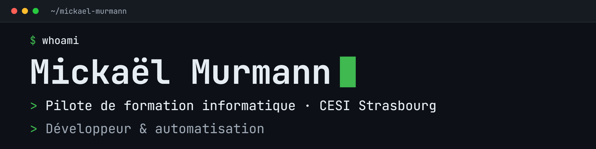

# Hi there, i'm Micka !
 

:triangular_flag_on_post: I am currently Head of Training at an engineering school.  

<!-- ## ⚡ Contribution Graph

 -->

## ⚡ Skills

:computer: Web Development

 

:art: Design

 
  

📎 Office

 

## ⚡ Stats

<!-- 
  
 -->

<!--
**mikeheul/mikeheul** is a ✨ _special_ ✨ repository because its `README.md` (this file) appears on your GitHub profile.

Here are some ideas to get you started:

- 🔭 I’m currently working on Symfony and Javascript projects
- 🌱 I’m currently learning React / Vue
- 👯 I’m looking to collaborate on ...
- 🤔 I’m looking for help with ...
- 💬 Ask me about ...
- 📫 How to reach me: ...
- 😄 Pronouns: ...
- ⚡ Fun fact: ...
-->
